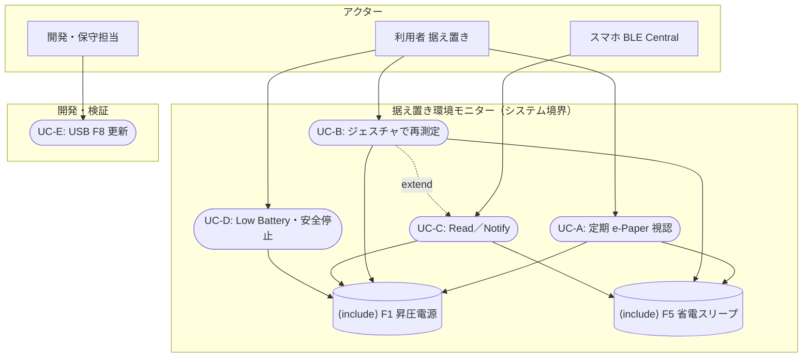

# ユースケース図（ドラフト）

**目的**：利用者視点で「何のメリットが得られるか」を固定し、[features.md](features.md) の F-ID と照合できるようにする。また **BLE がスマホへ渡す情報** は [architecture.md](architecture.md) の GATT ドラフトと一意にひも付ける。

**前提（要件の読み分け）**：

- **定期測定（約 10 分・F2）**は **e-Paper 更新まで**であり、要件上 **BLE の広告／GATT は開かない**（ウィンドウは **F6＝IMU ウェーク後**）。
- システム境界内では **昇圧（F1）**・**省電スリープ（F5）** が複数ユースケースで共通となるため、UML では **`<<include>>`** で表している（本章 **§2 の Mermaid** と同じ論理）。

---

## 1. アクター

| アクター | 説明 |
|----------|------|
| **利用者（据え置き）** | 設置場所・本体ディスプレイを主に視認するユーザー。電池/USB の供給形態のみに依存。 |
| **スマホ側（BLE Central）** | 広告ウィンドウ内に接続し **GATT で Read**。**Notify は CCCD により購読可**。**Write は設けない**前提。 |
| **開発／保守担当** | USB 経由フラッシュなど（**F8**）。エンドユーザー体験の主線から外側。 |

---

## 2. ユースケース図（主：Mermaid・Graphviz/`dot` 不要）

Markdown だけで読む場合は **本節を見れば足ります**（標準プレビューで図になりやすく、埋め込み PlantUML で `dot` を呼ぶこともありません）。

実線：**アクター → ユースケース** と **〈include〉**（共通の F1／F5 下地）。  
点線：**〈extend〉**（ほぼ **UC-B の直後・F6 の 60秒ウィンドウ**で UC-C が実用的）。

| 視覚 | 読み替え |
|------|----------|
| `UC-A`・`UC-B`・`UC-C` がいずれも `F1`・`F5` へ下向き | **include**：電源／省電は共通前提。 |
| `UC-D` → `F1` のみ | 停止文言・安全側ロジックの中心は電源状態（`F5` への線は省略可・詳細設計で追加可）。 |
| `UC-B` → 点線 → `UC-C` | **extend**：定期的な UC-A の **直後だけ** BLE を読む運用は **要件しない**（広告ウィンドウは IMUウェーク=F6）。 |
| `UC-E` 別グループ | エンドユーザー主線の外側 **F8**。 |

---

## 3. （任意）ローカルの PlantUML と `dot` が無いとき

**症状**：`Cannot run program "/opt/local/bin/dot"`

**Markdown（本ファイル）** … **§2 の Mermaid が主図**。**埋め込み PlantUML ブロックは置いていない**ので、Markdown プレビューだけなら **`dot` を呼ぶ経路がありません**。UML の楕円図の **単一ソース**は [use_case_diagram.plantuml](use_case_diagram.plantuml)。`*.plantuml` をプレビュー**するときのみ拡張が動きます。このリポ [.vscode/settings.json](../.vscode/settings.json) で **`PlantUMLServer`** を指定済み。**フォルダをワークスペースとして開いた状態**であれば、`dot` 無しでも描けることが多いです（ソースは送信先サーバー側で処理。※機密度が高い図には公開サーバー非推奨）。

記法：**`UCA ..> IncF1 <<include>>`** と **ステレオタイプは行末**。`: <<include>>` は避ける。

---

## 4. 機能一覧（F-ID）との対応

| UC-ID | ユースケース名 | 主な F-ID | 利用者メリット（一文） |
|-------|----------------|-----------|-------------------------|
| **UC-A** | 定期環境状態を e-Paper で視認 | **F2, F3, F4**（基盤 **F1, F5**） | ~10 分おきに **換気必要性・トレンド含む**状態を電源に頼らず目視確認できる。 |
| **UC-B** | ジェスチャで再測定し画面更新 | **F6** の測定〜表示部分（**F1, F5**） | **その場の空気**をすぐ確認でき、電子ペーパーでの **イベント駆動**利用ができる。 |
| **UC-C** | BLE Read／Notify でデータ取得 | **F6** の広告〜GATT 部分（**F1, F5**） | **Read** と **Notify** で数値ログをアプリ側へ。**サンプル番号インデックス**は本体発、**日時解釈はスマホ**（要件）。ポートフォリオでは Notify 受領のみでも可。**Write なし**。 |
| **UC-D** | 電池低下表示と安全停止 | **F7**（基盤 **F1**） | **不意のリセットより先に**低電状態を伝えられる（電圧監視回路・しきいは基本設計／TBD、[features.md](features.md)）。 |
| **UC-E** | （開発・検証）USB でファーム更新 | **F8** | 試作〜改善サイクルを回せる。エンド利用者ユースケースとは境界を分けて記載。 |

---

## 5. 「BLE でスマホへ伝える」の内容（要件ひも付け）

以下は **UC-C** でスマホが **Read** および **`CCCD` による Notify** で得られる論理項目。**特性・UUID・型の正**は [architecture.md](architecture.md) **「BLE GATT（ドラフト）」**。

| 項目 | 利用者／アプリ側の意味 |
|------|------------------------|
| **VOC Index** | Sensirion ベースの空気質指標。**画面と同系列**。 |
| **eCO₂（推計）** | VOC 由来の **参考 ppm 相当**。**真の CO₂ 計ではない**（[features.md](features.md) 非機能参照）。ログ用・傾向用。 |
| **サンプルインデックス** | **単調増加**。約10分サイクルの定期測定と **1:1 対応してよい**。装置は壁時計不要。**時系列ラベルはスマホ側**がインデックスに紐付ける（要件方針）。 |
| **FW ビルド識別子** | デモ時に実行中ファームを識別。 |

**Notify（ポートフォリオ）**：インデックス等を **1回 Notify だけ**でも **`Notify が動く状態`** を示せる。**履歴の連続バースト Notify は要件必須にしない**。**Write なし**。

**ウィンドウ制約**：**ラジオ ON・広告ウィンドウは最大 60 秒**/ウェーク（要件）。

---

## 6. 今後詰める点（要件→基本設計）

- ~~定期時は BLE を開けるか~~ → **要件上は開かない**。**将来変更する場合**は `features` の F6 定義を先に変更する。
- UC-C の事前条件文言をシーケンス図 ([`3_detailed_design/sequence_diagram.md`](../3_detailed_design/sequence_diagram.md)) と **完全一致**させるかは詳細設計で確定する。
- ユースケース名・番号が固まったら **シナリオテスト（受け入れ）** にそのまま転記できるようにする。

---

関連：[features.md](features.md)、[architecture.md](architecture.md)、[../SCOPE.md](../SCOPE.md)
