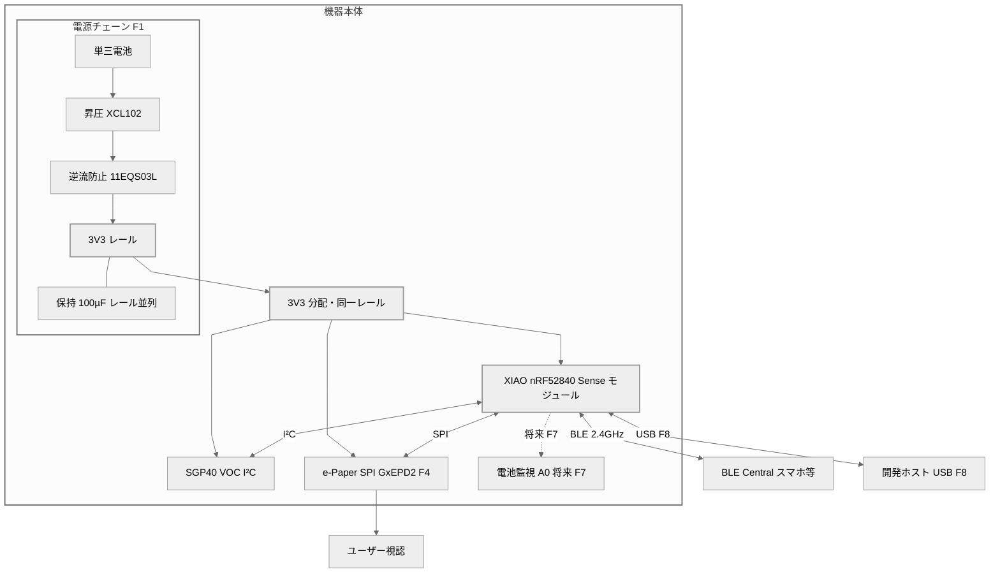
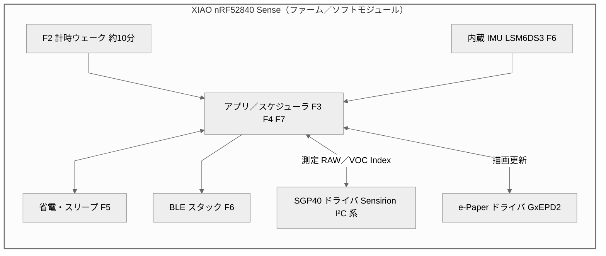
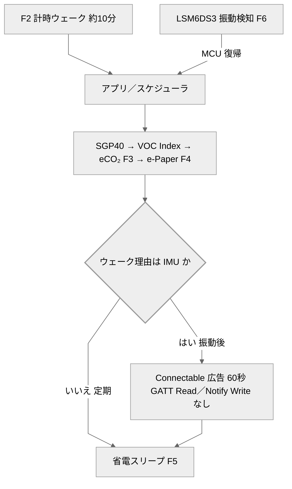

# コンポーネント図（ブロック図）

**根拠：** [../1_requirements/architecture.md](../1_requirements/architecture.md)、[../1_requirements/hardware_spec.md](../1_requirements/hardware_spec.md)、[../1_requirements/features.md](../1_requirements/features.md)。

本図は **機器本体の論理構成**と **主要データ／制御の流れ**を示す。電気的ピン番号の正は [../1_requirements/hardware_spec.md](../1_requirements/hardware_spec.md) **「GPIO／ピンアサイン」**。

---

## システム境界

| 境界内（本体） | 境界外 |
|----------------|--------|
| 単三〜昇圧電源チェーン、XIAO nRF52840 Sense（CPU・内蔵 BLE・内蔵 IMU）、SGP40、e-Paper | ユーザー（視認）、**BLE Central**（スマホ等）、開発ホスト（USB 書き込み・シリアル） |

---

## データフロー（主要シナリオ）

要件のアーキテクチャに沿い、**処理の心臓**は **MCU 上のアプリケーション／スケジューラ** とする。

### 据え置き・定期（F2〜F5）

1. **約10分周期**のウェーク（計時手段は基本設計の別項で確定）  
2. **SGP40** から VOC 系値取得 → **VOC Index** 正規化 → **独自 eCO₂ 推計（F3）**  
3. 結果を **RAM／Flash に保持しうる**（連番インデックスと紐付け）  
4. **SPI** で **e-Paper 更新（F4）**（ユーザー視認）  
5. **省電スリープ（F5）** へ戻る  

### IMU・BLE（F6）

1. スリープ中 **IMU** が振動等を検知 → **MCU 復帰**  
2. **SGP40 → VOC Index → eCO₂ → e-Paper 更新**（定期ウェークと同じパイプライン）  
3. **connectable 広告を 60 秒** — Central が **GATT Read／（CCCD 時）Notify** で当ウェーク値を取得可能。**Write なし**  
4. 窓終了後 **ラジオ停止** し再スリープ  

---

## 図（Mermaid）

**一次図は Mermaid とする**（プレビュー・GitHub 等で描画）。**図1は2枚に分割**する（同じことを1枚に詰めると、点線の給電・サブグラフの枠・信号線が重なり、テーマによっては「何の枠か」「どの矢印か」が判読しづらくなるため）。

**読み順のおすすめ：** 図1a（**電源と実体のつながり**）→ 図1b（**MCU 上のファーム論理＋周辺ドライバ**）→ 図2（**ウェーク種別と BLE 窓**）。細部は本文の「データフロー」と「モジュール一覧」で補う。

### 図1a — 電源・周辺・外部との関係（ハード／I/F 中心）

給電は **3V3 レールを1本** とみなし、ここでは **分配ノード1つ**にまとめて点線を減らす。信号は **実線**（I²C／SPI／USB／BLE／ユーザー視認）。

### 図1b — XIAO 上の論理コンポーネントと周辺ドライバ（ファーム／ソフト）

図1a の **`XIAO` モジュール内部**の分解。**アプリ**は **SGP40 ドライバ**／**e-Paper ドライバ（GxEPD2）**を介して周辺 IC にアクセスする（I²C／SPI の物理配線は **図1a**）。VOC Index→eCO₂ などのアルゴリズムは主にアプリ側（**F3**）。データの系列の流れは **図2** と本文「データフロー」参照。

ハード上の **SGP40／e-Paper チップ**そのものは **図1a** の周辺ブロックであり、本図では **ソフトの責務境界**のみ示す。

USB（F8）は **図1a** でホストと **XIAO モジュール**を接続している。物理コネクタとアプリの対応は詳細設計でよい。

### 図2 — ウェーク源と処理分岐（定期 vs IMU＋BLE）

定期（F2）でも IMU（F6）でも **測定パイプラインは同一**（実装では **図1b** の **SGP40 ドライバ**／**e-Paper ドライバ**を経由。ハードは **図1a**）。**BLE 広告 60 秒は F6 ウェーク後に限る**（要件 F6）。

---

## モジュール一覧

ハードを主に指すブロックと、**図1b のソフトモジュール**を同一表に載せる（行の説明で区別する）。

| ブロック名 | 役割 | 主な I/F |
|------------|------|----------|
| **電源チェーン** | 単三から実効〜2.9V 級 3V3 を供給（昇圧・逆流防止・ピーク吸収） | 電気：3V3／GND（[hardware_spec](../1_requirements/hardware_spec.md) 電源節） |
| **MCU プラットフォーム（XIAO）** | SoC、クロック、GPIO、USB；内蔵 BLE 用 RF | 電気：3V3；USB（D+/D− 等）；要件 **F8** |
| **アプリ／スケジューラ** | 定期ウェーク（F2）と IMU ウェーク（F6）の統合、測定→推計→表示の順序、低電池（F7）判断 | 論理：**ドライバ**・**BLE**・スリープ等へ要求（[interface_spec.md](interface_spec.md) で詳細化） |
| **SGP40 ドライバ（ソフト）** | Sensirion Arduino I²C SGP40 等で I²C 計測・生データ／VOC Index 取得をカプセル化（**図1b**） | 上位：**アプリ**。下位：MCU **I²C**（ピンは `hardware_spec`） |
| **e-Paper ドライバ（ソフト）** | **GxEPD2** でパネル制御・全面／部分更新（**図1b**） | 上位：**アプリ**。下位：MCU **SPI**／GPIO（`hardware_spec`） |
| **内蔵 IMU（LSM6DS3）** | スリープ中の振動検知によるウェーク（F6）；省電モードとの両立は詳細設計で確定 | GPIO／INT → MCU（`hardware_spec`「IMU とスリープ」） |
| **SGP40 センサ（ハード）** | VOC センサ IC 本体（ドライバ経由でアクセス） | **I²C**（電気的結線の正：`hardware_spec`） |
| **eCO₂ 推計（論理）** | VOC Index（と必要なら内部状態）から表示・BLE 用 eCO₂ を生成（**真 CO₂ は非測定**） | 入力：VOC Index 等／出力：数値・アイコン用区分 — **アプリ内**モジュールとしてもよい |
| **e-Paper 表示（ハード）** | 電子ペーパーモジュール本体（SPI バス上のスレーブ） | **SPI**（`hardware_spec`）；駆動は **GxEPD2** |
| **省電／スリープ制御** | System OFF／Deep Sleep 等への遷移、ウェーク源との整合（F5） | 割込・タイマ／アラーム（基本設計で計時方式と紐づけ） |
| **BLE スタック** | F6：**60 秒** connectable 広告、カスタムサービス、**Read 主／Notify 可／Write なし** | **2.4 GHz**；GATT 論理項目は [architecture.md](../1_requirements/architecture.md) ドラフト |
| **（将来）電池電圧監視** | A0 等でレール／分圧を読み、しきいで Low Battery 表示と安全停止（F7） | **アナログ入力**（回路未実装間はスタブ可 — **features F7**） |

---

## 備考

- **電気的接続・ピン番号の唯一の正**は [../1_requirements/hardware_spec.md](../1_requirements/hardware_spec.md)。
- **BLE GATT の UUID／型の確定**は [../1_requirements/architecture.md](../1_requirements/architecture.md) を正とし、[interface_spec.md](interface_spec.md) のブロック I/F と同期する。
- **処理ブロックの実装分割**（1 タスク／複数 FreeRTOS なしの Arduino 単一ループ等）は詳細設計の範囲。論理としては上表の境界で固定する。
