# 詳細クラス図／モジュール構成

**フェーズ:** 詳細設計  
**根拠:** [`../2_basic_design/block_diagram.md`](../2_basic_design/block_diagram.md)、[`../2_basic_design/interface_spec.md`](../2_basic_design/interface_spec.md)、[`../1_requirements/architecture.md`](../1_requirements/architecture.md)、[`../1_requirements/hardware_spec.md`](../1_requirements/hardware_spec.md)。

本書は **PlatformIO／Arduino／Adafruit nRF52** 上で、そのままヘッダ分割＋実装に落とせる粒度の **型名・API・依存** を規定する。基本設計のイベント／オペレーション ID は §4 で対応付ける。

---

## 1. GPIO ピンアサイン（`hardware_spec` 正）

[`hardware_spec.md`](../1_requirements/hardware_spec.md)「GPIO／ピンアサイン」の転記。ファームの **`pin_config.h`** は本表と一致させる。

| 周辺 | 信号 | XIAO D 番号 |
|------|------|-------------|
| SGP40 | SDA | **D4** |
| SGP40 | SCL | **D5** |
| e-Paper SPI | MOSI | D10 |
| e-Paper SPI | SCK | D8 |
| e-Paper SPI | CS | D1 |
| e-Paper SPI | DC | D3 |
| e-Paper SPI | RST | **D6** |
| e-Paper SPI | BUSY | **D7** |

I²C は Seeed 既定の **`Wire`**（D4/D5）を使用する。e-Paper 用 SPI は **`SPI`** ＋上記 CS/DC/RST/BUSY。

---

## 2. 定数・論理データ（実装でそのまま typedef／enum 化）

| 名前 | 値・型（暫定） | 備考 |
|------|----------------|------|
| `kWakeIntervalMs` | `600000`（10 分） | F2。実装では RTC／比較器の丸めで数秒ジッター許容。 |
| `kBleAdvertiseWindowMs` | `60000` | F6。 |
| `kSensorI2cAddressSgp40` | `0x59` | Sensirion SGP40 データシート。 |
| サービス UUID | `11111101-2222-4333-8444-A55555550001` | [`architecture.md`](../1_requirements/architecture.md) ドラフト。製品化前に正式 UUID へ。 |
| 特性 UUID | `...1101`〜`...1104` | 同上表。 |

```cpp
// include/app/types.h（想定配置）
enum class WakeReason : uint8_t { Timer10Min, ImuMotion, ColdBoot, Unknown };
enum class VentClass : uint8_t { Ok, Mild, High };      // D-ECO2-02 実装値は map 表で規定
enum class TrendClass : uint8_t { Flat, Up, Down };    // D-ECO2-03
enum class BleLinkState : uint8_t      { Idle, Advertising, Connected };
enum class Sgp40Error : uint8_t       { Ok, I2cNack, SelfTestFail, LowLevel }; // D-SGP-03 拡張可

struct MeasurementFrame {
  uint32_t   sampleIndex;   // D-APP-05, uint32 LE で GATT へ
  uint16_t   srawVoc;       // D-SGP-01
  int32_t    vocIndex;      // D-SGP-02／ガス指数（Sensirion process 出力、1..500 等）
  uint16_t   eco2Ppm;       // D-ECO2-01（表示・BLE 共通スナップショット）
  VentClass  vent;
  TrendClass trend;
};
```

**eCO₂ 推計:** 係数・区間は `Eco2Mapper` 内に閉じる（要件用語は *参考推計*／真 CO₂ 非測定）。入力は少なくとも **当サイクルの `vocIndex`** と **直前スナップショット**（トレンド用）。

**GxEPD2 ドライバクラス:** 実板 FPC／Waveshare Rev に合わせ **`GxEPD2_290_T94_V2`** または **`GxEPD2_290_C90`**（**(C)** 系）のいずれかを `epd_driver.h` の typedef で一元化する。下記 Mermaid は **`GxEPD2_290_T94_V2`** を代表とする。

---

## 3. Mermaid：アプリ／自前ラッパと公式ライブラリの関係

```mermaid
classDiagram
  direction TB

  class ApplicationController {
    -StateMachine sm_
    -MeasurementFrame lastFrame_
    -WakeReason pendingWake_
    +setup()
    +loop()
    -runMeasurePipeline()
    -runBleWindowIfNeeded()
    -armSleepAndYield()
  }

  class StateMachine {
    <<utility>>
    +State current()
    +onEvent(Event)
  }

  class Sgp40Pipeline {
    -SensirionI2CSgp40 sgp_
    -VOCGasIndexAlgorithm vocAlg_
    +begin(TwoWire& w) bool
    +measureVocIndex(uint16_t& srawOut, int32_t& vocOut) Sgp40Error
    +heaterOffForSleep() void
  }

  class Eco2Mapper {
    +snapshotFromVoc(int32_t vocIndex, const MeasurementFrame* prev, MeasurementFrame& out) void
  }

  class EpdPresenter {
    -GxEPD2_Bw display_
    +begin() bool
    +show(const MeasurementFrame& m) void
    +hibernatePanel() void
  }

  class ImuWakeSource {
    -Lsm6ds3Accel imu_
    +begin() bool
    +configureWakeOnMotion(uint8_t threshMg) bool
    +clearIrqFlags() void
  }

  class SleepController {
    +configureGpioSenseWakeup(uint32_t pinNumber) void
    +armRtcWakeupSeconds(uint32_t sec) void
    +enterSystemOffOrDeepSleep() void
  }

  class EnvBleService {
    -BLEService service_
    -BLECharacteristic chrVoc_
    -BLECharacteristic chrEco2_
    -BLECharacteristic chrSeq_
    -BLECharacteristic chrFw_
    +begin(const MeasurementFrame& snap) void
    +updateGattSnapshot(const MeasurementFrame& snap) void
    +startAdvertising(uint32_t windowMs) void
    +stopAdvertising() void
    +notifySubscribed() void
  }

  class BatteryMonitor {
    <<stub F7>>
    +sampleMv() uint16_t
    +isLow() bool
  }

  ApplicationController --> StateMachine
  ApplicationController --> Sgp40Pipeline
  ApplicationController --> Eco2Mapper
  ApplicationController --> EpdPresenter
  ApplicationController --> ImuWakeSource
  ApplicationController --> SleepController
  ApplicationController --> EnvBleService
  ApplicationController --> BatteryMonitor

  Sgp40Pipeline ..> SensirionI2CSgp40 : uses
  Sgp40Pipeline ..> VOCGasIndexAlgorithm : uses

  class SensirionI2CSgp40 {
    <<Sensirion/arduino-i2c-sgp40>>
    +begin(TwoWire&)
    +measureRawSignal(rhTicks, tempTicks, srawVoc) uint16_t
    +executeSelfTest(testResult) uint16_t
    +turnHeaterOff() uint16_t
    +getSerialNumber(buf, size) uint16_t
  }

  class VOCGasIndexAlgorithm {
    <<Sensirion/arduino-gas-index-algorithm>>
    +VOCGasIndexAlgorithm()
    +VOCGasIndexAlgorithm(float samplingIntervalSec)
    +process(int32_t sraw) int32_t
    +set_tuning_parameters(...)
    +reset()
  }

  class GxEPD2_Bw {
    <<GxEPD2 GxEPD2_BW Driver HEIGHT>>
    +init(uint32_t serialDiag)
    +setRotation(uint8_t)
    +setFullWindow()
    +firstPage() bool
    +nextPage() bool
    +hibernate()
  }

  class Lsm6ds3Accel {
    <<Adafruit LSM6DS — Adafruit_LSM6DS3TRC>>
    +begin_I2C(addr, wire)
    +setAccelRange(range)
    +setAccelDataRate(rate)
    +enableWakeup(en, duration, thresh)
    +configInt1(...)
    +awake() bool  %% reads WAKE_UP_SRC(0x1B) — cleared on read
  }

  class BLEService {
    <<Adafruit Bluefruit>>
    +begin()
  }
  class BLECharacteristic {
    <<Adafruit Bluefruit>>
    +setProperties(prop)
    +setPermission(r, w)
    +write(data, len)
    +notify(data, len)
    +begin()
  }

  EpdPresenter --> GxEPD2_Bw
  ImuWakeSource --> Lsm6ds3Accel
  EnvBleService --> BLEService
  EnvBleService --> BLECharacteristic
```



---

## 4. 基本設計 I/F ID とクラスオペレーション対応（トレーサビリティ）

| interface_spec | 実装側の責務 |
|------------------|----------------|
| E-APP-01 計時ウェーク | `SleepController` 復帰 ＋ `ApplicationController` が `WakeReason::Timer10Min` |
| E-APP-02 IMU ウェーク | GPIO ／ IMU INT 復帰 ＋ `WakeReason::ImuMotion` |
| OP-APP-01 測定パイプライン | `Sgp40Pipeline::measureVocIndex` → `Eco2Mapper::snapshotFromVoc` |
| OP-APP-02 表示更新 | `EpdPresenter::show` |
| OP-APP-03 スリープ | `Sgp40Pipeline::heaterOffForSleep` → `EpdPresenter::hibernatePanel` → `SleepController::enter...` |
| OP-APP-04 BLE ウィンドウ | `EnvBleService::startAdvertising`、60 秒で `stopAdvertising` |
| OP-TMR-01 | `SleepController::armRtcWakeupSeconds(600)`（実装で秒に丸め） |
| OP-IMU-01 | `ImuWakeSource::configureWakeOnMotion` |
| OP-SGP-01〜03 | `Sgp40Pipeline` が `SensirionI2CSgp40::begin`／`measureRawSignal`／`turnHeaterOff` に委譲 |
| OP-ECO2-01 | `Eco2Mapper::snapshotFromVoc` |
| OP-EPD-01〜03 | `EpdPresenter::begin`／`show`／`hibernatePanel`（内部で GxEPD2） |
| OP-BLE-01〜04 | `EnvBleService` |
| GATT 値 | `MeasurementFrame` を LE 直列化して `BLECharacteristic::write`、Notify は `notify` |

---

## 5. ファイル粒度（`4_implementation/` との対応目安）

| ファイル（想定） | 主要クラス／内容 |
|------------------|------------------|
| `src/main.cpp` | `setup()`／`loop()` が `ApplicationController` に委譲のみ |
| `src/app/ApplicationController.cpp` | `StateMachine` による状態遷移と、`interface_spec` の OP-APP-xx オーケストレーション |
| `src/app/StateMachine.{h,cpp}` | 列挙 `State`／`Event` と遷移表（`state_machine.md` と同一） |
| `src/sensor/Sgp40Pipeline.{h,cpp}` | Sensirion 公式 2 ライブラリの唯一の束ね |
| `src/sensor/Eco2Mapper.{h,cpp}` | [`interface_spec.md`](../2_basic_design/interface_spec.md) §3.5（VOC Index／eCO₂ 推計）のスナップショット契約 |
| `src/display/EpdPresenter.{h,cpp}` | GxEPD2 インスタンス保持・描画レイアウト |
| `src/io/ImuWakeSource.{h,cpp}` | LSM6DS3 ウェーク設定（Seeed Wiki／ST DS 準拠のレジスタ設定へ） |
| `src/power/SleepController.{h,cpp}` | Nordic／Adafruit 省電 API のラッパ |
| `src/ble/EnvBleService.{h,cpp}` | `Bluefruit`、`BLEService`、4 特性 |
| `src/power/BatteryMonitor.{h,cpp}` | F7 スタブ（`analogRead(A0)` 等は回路実装後に） |
| `include/app/types.h` | §2 の構造体・列挙 |
| `include/app/pin_config.h` | §1 のマクロ |

---

## 6. 公式 API 呼び出しパターン（実装メモ）

### 6.1 Sensirion SGP40 ＋ VOC Index

- **`SensirionI2CSgp40::begin(Wire)`** … I²C 起動後に一度。
- **`measureRawSignal(0x8000, 0x6666, srawVoc)`** … RH／温度未補正のデフォルト_ticks（ヘッダ Doxygen と同値）。戻り値 **0**＝成功（非 0 は `Sgp40Error` へマップ）。
- **`VOCGasIndexAlgorithm::process((int32_t)srawVoc)`** … 返り値を `vocIndex` として後段へ。**約 10 分間欠**の場合はコンストラ **`VOCGasIndexAlgorithm(600.0f)`**（秒）を採用し、ウェーク毎に **1 サンプル**だけ `process` する（アルゴリズム README が想定する 1 s 連続より学習は遅くなるが、製品方針は間欠電力優先。起動直後にのみ短時間バーストを足すかは実装ゲート）。
- スリープ前に **`turnHeaterOff()`** をベストエフォートで呼ぶ（F5／データシート）。

### 6.2 GxEPD2

- グローバル **`display`**（例: `GxEPD2_BW<GxEPD2_290_T94_V2, GxEPD2_290_T94_V2::HEIGHT> display(...);`）を `EpdPresenter` が所有。
- **`init`** → **`setFullWindow()`** → **`setTextColor/Background`** → **`println`/ビットマップ** → **`display()`**（`firstPage`／`nextPage` ループ）は [GxEPD2 examples](https://github.com/ZinggJM/GxEPD2) に合わせる。
- 更新後 **`hibernate()`** でパネル電源抑制（Wiki／ライブラリ準拠）。

### 6.3 LSM6DS3（IMU）

- **I²C ドライバ** … Adafruit 系・SparkFun 系など **Adafruit nRF52 core とリンク競合しない**公式／準公式ライブラリを `platformio.ini` で固定する（`ImuWakeSource` が薄くラップ）。
- **`begin_I2C()`** … アドレス **0x6A / 0x6B** は XIAO Sense 基板図で確定。

### 6.4 Adafruit Bluefruit（BLE）

- **`Bluefruit.begin()`** … 起動時 1 回。SoftDevice 初期化。
- **`envService.begin()`** … カスタム UUID128（`BLEUuid` にフル文字列）。
- 各 **`BLECharacteristic`** … `CHR_PROPS_READ \| CHR_PROPS_NOTIFY`、**Write 権限なし**（`SECMODE_OPEN`／NO_ACCESS）。
- **`Bluefruit.Advertising.addFlags(BLE_GAP_ADV_FLAGS_LE_ONLY_GENERAL_DISC_MODE)`**、必要なら TxPower、`addService(envService)`、**connectable** で **`start(timeoutSec)`** または `start(0)` ＋自前 `millis()` で 60 秒打切り（API の timeout 挙動は Adafruit 版に合わせ実装）。
- スナップショット更新時 **`chr.write(&u16, sizeof)`**、接続済みで CCCD active なら **`notify`**（**...1103** サンプルインデックスは接続直後に 1 回送る用途を推奨）。

### 6.5 省電（nRF52840）

**スリープ方式：WFE Deep Sleep（System OFF 不採用）**

`sd_power_system_off()` は RAM 消去・RTC 停止を伴うため、「RTC 10 分タイマ」と「IMU GPIO 割り込み」の **両ウェークソースを同時に有効にできない**。本実装は **`waitForEvent()` ループ（WFE Deep Sleep）** を採用する。

- **`SleepController::enterSystemOffOrDeepSleep()`** … RTC2 Compare（10 分）と IMU INT1 GPIO interrupt の両方を arm してから `waitForEvent()` ループへ入る。どちらかが発火したらループを抜け、`lastWake_` に `WakeReason` を記録する。RAM は保持されるため復帰後にそのまま参照可能。
- **入眠前ペリフェラル停止**（`ApplicationController::armSleepAndYield()` 内で実施）：
  - `Wire.end()` / `Wire1.end()` … SGP40・IMU の I²C バスを停止。IMU は `configureWakeOnMotion()` 設定後は自律動作するため停止可。
  - `SPI.end()` … e-Paper SPI バスを停止（パネルは `hibernatePanel()` 済み）。
- **IMU 電源ピン（`kImuPower`）は HIGH 維持** … GPIO 出力状態は WFE では保持されるため IMU は動き続ける。
- **F6 の 60 秒以外はラジオ停止**（`stopAdvertising()` で保証）をコードレビューで確認。

---

## 7. 備考

- `SensirionI2CSgp40` の依存 **`Sensirion Core`** は `platformio.ini` の `lib_deps` に明示する。
- **Mbed 系**の Seeed サンプルは要件上対象外（[`interface_spec.md`](../2_basic_design/interface_spec.md) §3.2）。
- 本クラス分割は最小限。テスト容易化で `Eco2Mapper` だけ別 TU に切り出す／モック `Sgp40Pipeline` を増やす余地はあるが、初版は上記で十分である。
