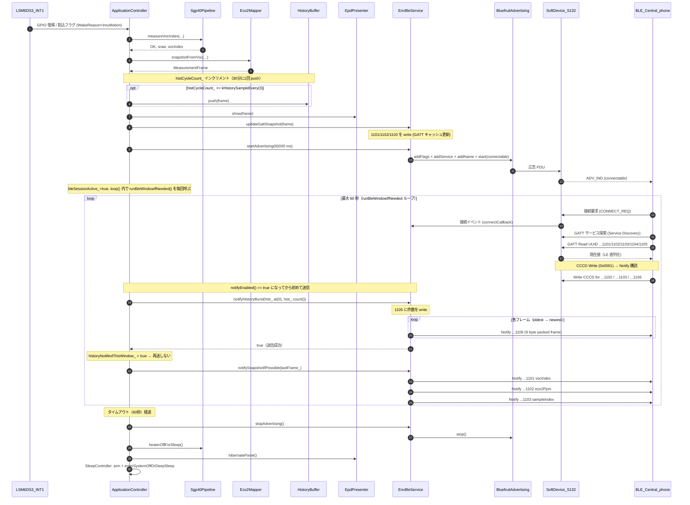
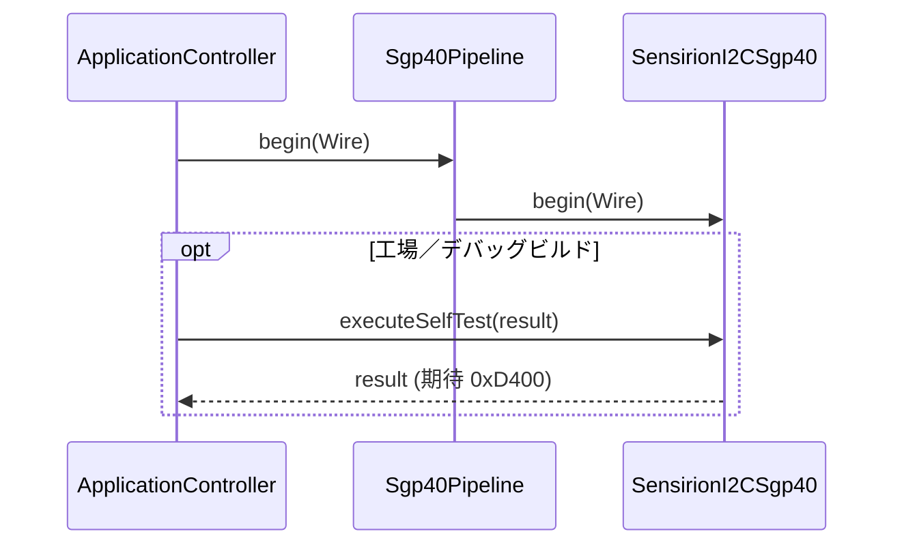
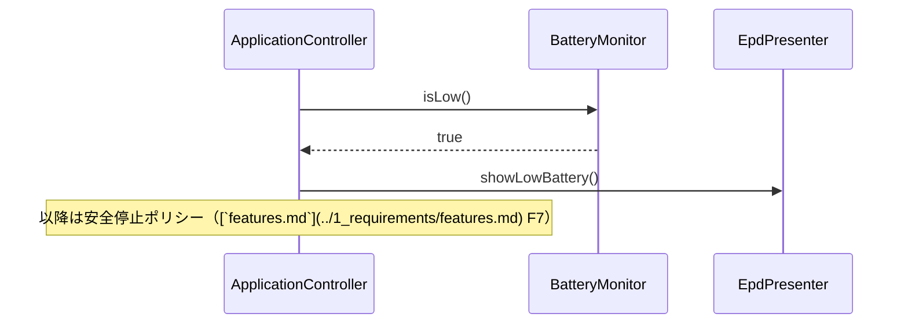

# シーケンス図

**フェーズ:** 詳細設計  
**根拠:** [`block_diagram.md`](../2_basic_design/block_diagram.md)、[`interface_spec.md`](../2_basic_design/interface_spec.md)、[`architecture.md`](../1_requirements/architecture.md) BLE 表、[ユースケース補助 `use_case_diagram.md`](../1_requirements/use_case_diagram.md)。

オブジェクト名は [`class_diagram.md`](class_diagram.md) のクラスに一致させる。**公式ライブラリ**は構造図と同じ実名で記載する。

---

## シナリオ A — 定期ウェーク（F2のみ、BLE なし）

**前提:** 約10分 RTC 復帰。IMU はバックグラウンドで待ち受けているが **当サイクルはタイマ主導**。

```mermaid
sequenceDiagram
  autonumber
  participant RTC as nRF RTC / 比較_WAKEUP
  participant App as ApplicationController
  participant Slp as SleepController
  participant SGP as Sgp40Pipeline
  participant DEV as SensirionI2CSgp40
  participant VOC as VOCGasIndexAlgorithm
  participant MAP as Eco2Mapper
  participant HB as HistoryBuffer
  participant EPD as EpdPresenter
  participant GX as GxEPD2_3C

  RTC->>App: CPU 復帰 (WakeReason=Timer)
  App->>SGP: measureVocIndex(sraw, vocIdx)
  SGP->>DEV: measureRawSignal(0x8000, 0x6666, srawVoc)
  DEV-->>SGP: err==0, srawVoc
  SGP->>VOC: process((int32_t)srawVoc)
  VOC-->>SGP: vocIndex (int32_t)
  SGP-->>App: OK, sraw, vocIndex

  App->>MAP: snapshotFromVoc(vocIndex, prev, frame)
  MAP-->>App: MeasurementFrame 確定 (index++, eco2, vent, trend)

  Note over App,HB: histCycleCount_ をインクリメント
  opt histCycleCount_ >= kHistorySampleEvery(3) → 約30分に1回
    App->>HB: push(frame)
    Note over App: histCycleCount_ リセット
  end

  App->>EPD: show(frame)
  EPD->>GX: init / setFullWindow / print / display (first/next loop)
  GX-->>EPD: 描画完了
  EPD->>GX: hibernate()
  Note over App: WakeReason!=ImuMotion → BLE スキップ (OP-APP-04)

  App->>SGP: heaterOffForSleep()
  SGP->>DEV: turnHeaterOff()

  App->>Slp: armRtcWakeupSeconds(600); configureGpioSense(IMU_PIN)
  App->>Slp: enterSystemOffOrDeepSleep()
```

---

## シナリオ B — IMU ウェーク（F6：測定→表示→BLE 60秒→スリープ）

**前提:** `ImuWakeSource` が LSM6DS3 の WAKE_UP を **nRF sense ピン**へ届け済み。復帰後 `WakeReason=ImuMotion`。



**重要な実装上の制約:** CCCD 購読（Notify 有効化）は **接続完了後にスマートフォン側が明示的に Write** することで行われる。接続直後は `notifyEnabled() == false` であるため、`notifyHistoryBurst()` は `notifyEnabled()` が true になるまでループごとに再試行し、送信できた時点で `historyNotifiedThisWindow_ = true` をセットして以降の重複送信を防ぐ。

**GATT 値の直列化（実装契約）**

| 特性 UUID（末尾） | プロパティ | `BLECharacteristic::write` / Notify 内容 |
|-------------------|------------|-------------------------------------------|
| `...1101` | READ, NOTIFY | `(uint16_t)vocIndex` — uint16 にクランプ（0–65535） |
| `...1102` | READ, NOTIFY | `(uint16_t)frame.eco2Ppm` LE |
| `...1103` | READ, NOTIFY | `(uint32_t)frame.sampleIndex` LE |
| `...1104` | READ | 固定長 ASCII 16 bytes（例：`"0.1.0\0"`） |
| `...1105` | READ | `(uint16_t)count` — 履歴バッファ件数（送信時に更新） |
| `...1106` | NOTIFY | 9 byte packed frame（oldest → newest 順に逐次 Notify）:<br>`[0..3]` sampleIndex uint32 LE<br>`[4..5]` vocIndex int16 LE（クランプ ±32767）<br>`[6..7]` eco2Ppm uint16 LE<br>`[8]` flags: bits[1:0]=vent, bits[3:2]=trend |

---

## シナリオ C — 初回起動とセルフテスト（開発／製造オプション）

**目的:** [`SensirionI2CSgp40::executeSelfTest`](https://github.com/Sensirion/arduino-i2c-sgp40) を **S1 `HW_INIT`** で任意実行し、`0xD400` 以外なら S7。



---

## シナリオ D — F7 低電池（回路実装後）

将来：`BatteryMonitor::isLow()` が true のとき **S6** へ分岐し、`EpdPresenter` に Low Battery 専用画面。以降 `SleepController` で極浅いポーリングのみ、または停止。



---

## Mermaid 記法・ツールについて

- GitHub／多くの VS Code 拡張で **`sequenceDiagram`** を描画可能。
- 本ドキュメントでは `participant GX as GxEPD2_BW` のように、C++ テンプレート引数は書かず短縮している（レンダラ互換のため）。実体は `class_diagram.md` の GxEPD2 節に従う。

---

## トレーサビリティ

| シナリオ | 機能 ID / ユースケース |
|----------|------------------------|
| A | F2, F3, F4, F5 |
| B | F3, F4, F6（Read／Notify：1101/1102/1103/1105/1106、CCCD 購読後にバースト送信） |
| C | F2 初期化品質 |
| D | F7 |
