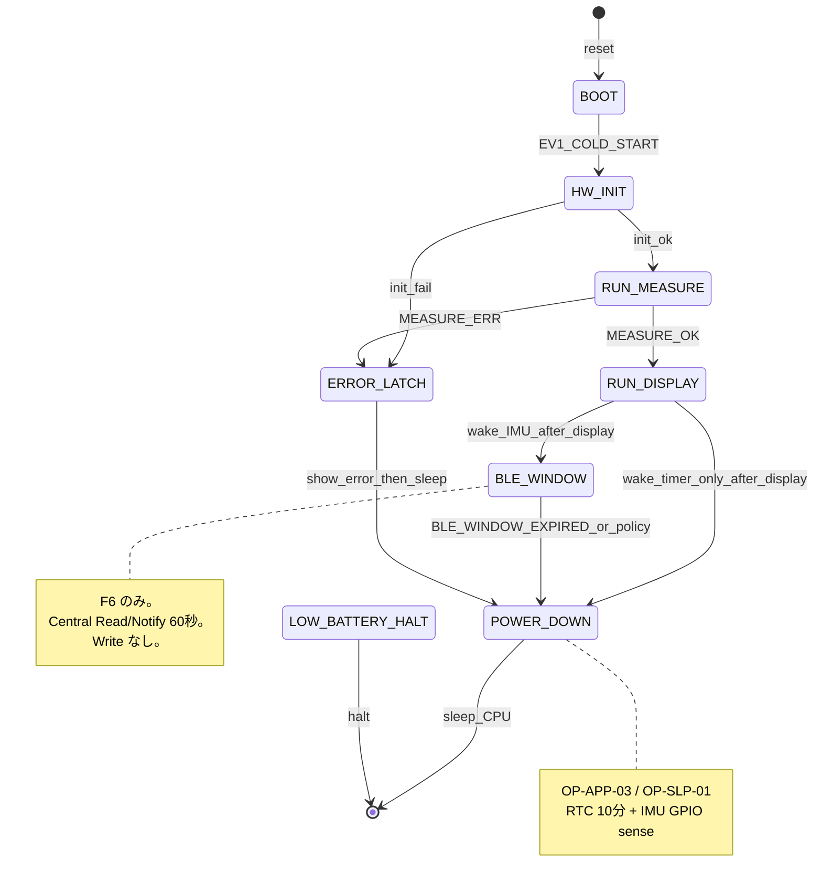

# アプリケーション状態遷移（ステートマシン）

**フェーズ:** 詳細設計  
**根拠:** [`../2_basic_design/block_diagram.md`](../2_basic_design/block_diagram.md) 図2、[`interface_spec.md`](../2_basic_design/interface_spec.md) §3.1（アプリ／スケジューラ）、[`class_diagram.md`](class_diagram.md)。

`ApplicationController`＋`StateMachine` が唯一の制御点とする。**RTOS／マルチタスクは採用しない**（Arduino 単一 `loop`）。各状態のエントリで **べき等**に同期 I/O を完走させ、終端で **`ENTER_SLEEP` へ落とす**か **BLE ウィンドウだけ残す**。

---

## 1. 状態一覧

| ID | 状態名 | 説明 | 代表的な block_diagram / I/F |
|----|--------|------|-------------------------------|
| S0 | `BOOT` | 電源投入・リセット直後。レジスタ／ライブラリの cold 初期化 | — |
| S1 | `HW_INIT` | `SensirionI2CSgp40::begin`、`GxEPD2::init`、`Bluefruit.begin`、IMU ウェーク設定、GATT 登録 等 | OP-SGP-01, OP-EPD-01, OP-BLE-02 |
| S2 | `RUN_MEASURE` | SRAW → VOC Index → eCO₂ スナップショット確定 | OP-APP-01, OP-ECO2-01 |
| S3 | `RUN_DISPLAY` | e-Paper 全面／部分更新 | OP-APP-02, OP-EPD-02 |
| S4 | `BLE_WINDOW` | IMU ウェーク時のみ。広告 60 秒、`loop` 内で接続・Read／Notify 処理 | OP-APP-04, OP-BLE-01, F6 |
| S5 | `POWER_DOWN` | ヒータオフ、パネル `hibernate`、次ウェーク設定、System OFF／Deep Sleep へ | OP-APP-03, OP-SGP-03, OP-EPD-03, OP-SLP-01 |
| S6 | `LOW_BATTERY_HALT` | （F7 実装後）表示のみ更新し以降測定停止。未実装時は未到達で可 | E-BAT-01 |
| S7 | `ERROR_LATCH` | （任意）センサ自己診断失敗等。画面にエラー文＋安全停止 | D-SGP-03 |

**スリープ中**は CPU が停止するため状態は保持されない。復帰後は **`WakeReason`**（RTC／GPIO／boot）をハード／SDK から取得し **S2 以降に直結**する設計とする（状態 S0 は cold boot のみ）。

---

## 2. イベント一覧

| ID | イベント | 発生源 |
|----|----------|--------|
| EV1 | `COLD_START` | リセットベクトル |
| EV2 | `WAKE_TIMER_10MIN` | RTC／比較器（計時ウェーク E-TMR-01） |
| EV3 | `WAKE_IMU` | LSM6DS3 INT（E-IMU-01） |
| EV4 | `MEASURE_OK` | パイプライン正常終了 |
| EV5 | `MEASURE_ERR` | I²C 等（S7 へ、またはリトライ方針を別紙） |
| EV6 | `DISPLAY_DONE` | GxEPD2 更新完了 |
| EV7 | `BLE_WINDOW_EXPIRED` | `millis()` またはタイマ（E-BLE-02） |
| EV8 | `LOW_BATTERY` | `BatteryMonitor`（将来） |
| EV9 | `FORCE_BLE` | `WakeReason::ImuMotion` のときパイプライン後に S4 必須 |

---

## 3. 遷移表

| From | イベント／条件 | To | アクション（エントリ） |
|------|----------------|-----|-------------------------|
| — | リセット | S0 | 変数初期化、WDT 等 |
| S0 | 常に | S1 | `HW_INIT` 一括 |
| S1 | 初期化成功 | S2 | `Sensirion` ウォームアップ方針に従い `measureRaw` |
| S1 | 初期化失敗 | S7 | 画面に「センサ障害」等 |
| S2 | `MEASURE_OK` | S3 | `Eco2Mapper` 済みの `MeasurementFrame` を渡す |
| S2 | `MEASURE_ERR` | S7 または S5 | ポリシー：3 回リトライ後ラッチ＋スリープ可 |
| S3 | `DISPLAY_DONE`（同期完了） | S4 or S5 | **`WakeReason==ImuMotion` → S4**、それ以外 → S5 |
| S4 | 入口 | — | `EnvBleService::startAdvertising`、`updateGatt`、CCCD notify 任意 |
| S4 | `BLE_WINDOW_EXPIRED` or 接続切断後方針 | S5 | `stopAdvertising`、SoftDevice 省電へ |
| S5 | 直前が正常 | — | `turnHeaterOff`、`display.hibernate`、次 RTC＋GPIO sense、`enterSystemOffOrDeepSleep` |
| S5 | `LOW_BATTERY` 検知（将来） | S6 | Low Battery 画面 |
| S6 | — | — | ウォッチドッグ停止等、手動リセットまで停止 |
| S7 | — | S5 | エラー表示後でも電力救出のためスリープ可 |

**IMU 以外のウェーク**では **S4 に入らない**（[`interface_spec.md`](../2_basic_design/interface_spec.md) 前提）。

---

## 4. Mermaid 状態遷移図

`BOOT`／`HW_INIT` を図示上まとめてもよいが、実装では **setup() が S0→S1**、**最初のパイプラインが S2** を明示するとレビューしやすい。

---

## 5. `loop()` と状態の対応

| モード | `loop()` の役割 |
|--------|------------------|
| S2〜S3 | 短時間で完走。**ブロッキング可**（同期設計） |
| S4 | **非ブロッキングに近づける**：SoftDevice ポーリング、`Bluefruit.connected()`、60 秒打切りのみ監視 |
| S5 へ遷移直後 | **`enterSystemOffOrDeepSleep` を呼び、`loop` は事実上到達しない** |

復帰後は **ハードウェア起因のイベント**から `WakeReason` を再構築し、**S2 から再起**する（`setup` は再実行されないパスが大半）。

---

## 6. 基本設計イベントとの対応

| interface_spec | 本ステートマシンでの扱い |
|----------------|-------------------------|
| E-APP-01 | `WAKE_TIMER_10MIN` → S2 入口。タイマ起因のときは S4 を挟まず測定・表示のあと S5（スリープ準備）へ（`interface_spec` の「定期時は BLE なし」） |
| E-APP-02 | `WAKE_IMU` → S2、表示後 S4 |
| E-APP-03 | S5 のアクション |
| E-BLE-02 | S4 内タイマ → S5 |
| E-SLP-01 | S5 完了後の CPU 停止 |

---

## 7. 図（参照）

- ブロック図上の分岐: [`block_diagram.md`](../2_basic_design/block_diagram.md) **図2**
